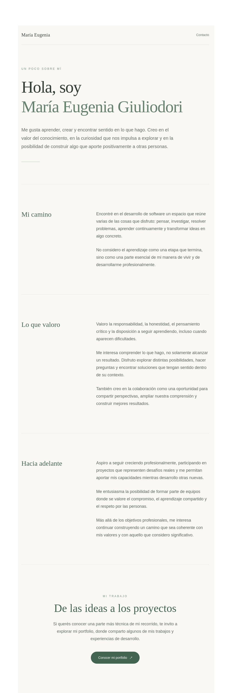

# Hola, soy María Eugenia Giuliodori 🌿

¡Bienvenida/o a mi espacio en GitHub!

Soy desarrolladora de software y disfruto aprender, explorar ideas y transformar desafíos en oportunidades para crear.

Además de compartir código, me interesa mostrar un poco de quién soy, cómo fui construyendo mi camino profesional y qué me motiva a seguir creciendo.

Por eso creé una pequeña página de presentación personal y profesional.

### Un poco sobre mí

**[🌿 Conocé mi presentación profesional](https://eugeniagiuliodori.vercel.app/)**

Desde allí también podés acceder a mi portfolio técnico, donde comparto proyectos y experiencias de desarrollo.

---

*Gracias por visitar mi espacio.*
